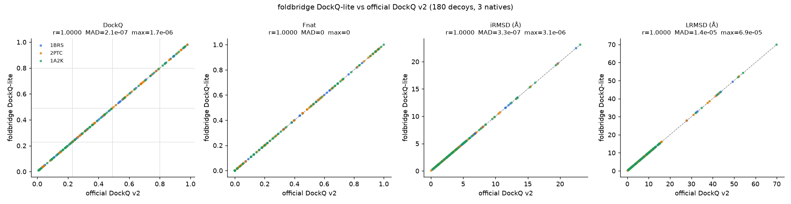

# Validation: foldbridge DockQ-lite vs official DockQ v2

foldbridge computes DockQ in pure numpy (`foldbridge.score.dockq_lite`, which
`score_structure(model, reference=native)` calls for two-chain complexes). This page checks it
against the reference implementation, **DockQ v2** (Mirabello & Wallner 2024; package `DockQ`
2.1.3, Basu & Wallner), on 180 decoys built from three crystal complexes.

**Result.** On all 180 decoys foldbridge matches DockQ v2 to within **2×10⁻⁶ DockQ**, and every
decoy lands in the same CAPRI class. Fnat is identical on every decoy, iRMSD agrees to 3×10⁻⁶ Å and
LRMSD to 7×10⁻⁵ Å; what is left is float32 (PDB) vs float64 coordinate round-off. This is after the
insertion-code fix in `foldbridge/score.py` ([below](#insertion-codes-fixed)). Before it, 2PTC was off
by up to 6.9×10⁻⁴ DockQ / 0.068 Å iRMSD because 184/184A, 188/188A and 221/221A were merged.



## Agreement (180 decoys, 3 natives)

Numbers from the post-fix rerun of `validation/run_dockq_validation.py` (DockQ 2.1.3, same seed,
same decoys; the regenerated fixtures are byte-identical to the stored ones).

| metric | Pearson r | Spearman ρ | mean \|Δ\| | max \|Δ\| (decoy) |
|---|---|---|---|---|
| DockQ | 1 − 6×10⁻¹³ | 1.0 | 2.1×10⁻⁷ | 1.7×10⁻⁶ (1A2K_17_graded) |
| Fnat | 1.0 | 1.0 | 0 | 0 |
| iRMSD (Å) | 1 − 8×10⁻¹⁵ | 1.0 | 3.3×10⁻⁷ | 3.1×10⁻⁶ (1BRS_58_far) |
| LRMSD (Å) | 1 − 1×10⁻¹² | 1.0 | 1.4×10⁻⁵ | 6.9×10⁻⁵ (1A2K_17_graded) |

Per native (max \|Δ\|):

| native | interface | n | DockQ range (official) | Fnat | iRMSD (Å) | LRMSD (Å) | DockQ |
|---|---|---|---|---|---|---|---|
| 1BRS | barnase A / barstar D | 60 | 0.014–0.980 | 0 | 3×10⁻⁶ | 2.5×10⁻⁵ | 1×10⁻⁶ |
| 2PTC | trypsin E / BPTI I (insertion codes 184A, 188A, 221A) | 60 | 0.013–0.980 | 0 | 2×10⁻⁶ | 4.9×10⁻⁵ | 1×10⁻⁶ |
| 1A2K | Ran D / NTF2 A | 60 | 0.008–0.967 | 0 | 3×10⁻⁶ | 6.9×10⁻⁵ | 2×10⁻⁶ |

Pre-fix, the 2PTC row read iRMSD 0.068 Å, LRMSD 0.010 Å, DockQ 6.9×10⁻⁴ (the other two rows are
unchanged). The leftover ~10⁻⁵ Å differences come from float32 vs float64 coordinates.

**CAPRI classification** (incorrect < 0.23 ≤ acceptable < 0.49 ≤ medium < 0.80 ≤ high):
**180/180 agree**. Rows are the official class and columns the foldbridge class; the matrix is
diagonal.

| official \ foldbridge | incorrect | acceptable | medium | high |
|---|---|---|---|---|
| incorrect (61) | 61 | 0 | 0 | 0 |
| acceptable (56) | 0 | 56 | 0 | 0 |
| medium (39) | 0 | 0 | 39 | 0 |
| high (24) | 0 | 0 | 0 | 24 |

**Control experiments**
* *2PTC renumbered.* The same 60 2PTC decoys were scored after renumbering residues 1..n with no
  insertion codes. foldbridge matches DockQ to max \|ΔDockQ\| = 1.0×10⁻⁶, the same as with the
  original numbering now that insertion codes are handled. (Before the fix this control was how the
  2PTC deviation was isolated to insertion-code handling.) DockQ aligns by sequence, so its own
  values do not change.
* *Raw PDB entries as reference.* Every 6th decoy (30) was also scored against the unmodified
  `tests/data/*.pdb`, which include other chains, waters, HETATM ligands (GDP/Mg²⁺ on Ran, Ca²⁺ on
  trypsin) and altlocs (1BRS Ser D14). The official DockQ value is unchanged (max \|Δ\| = 0).
  foldbridge stays within the same bounds: max \|Δ\| Fnat 0, iRMSD 1.7×10⁻⁶ Å, LRMSD 4.9×10⁻⁵ Å,
  DockQ 1.0×10⁻⁶ (pre-fix: 6×10⁻⁴, all on 2PTC).
* *DockQ CLI vs python API.* `DockQ model native --mapping …` (3 d.p. output) equals the API value
  on the 5 decoys checked.

## Method

1. **Natives** (`validation/run_dockq_validation.py`). Protein heavy atoms of the two chains are
   taken from `tests/data/{1BRS,2PTC,1A2K}.pdb` with `foldbridge.structure` and written with
   `Structure.write_pdb`. The chain map is identity, since all ids are single letters. Both tools
   score the same files.
2. **Decoys** (seed 20261009; 60 per native):
   * **50 graded rigid-body decoys.** The ligand (smaller chain) is rotated about its centroid by
     up to 60° × severity and translated by up to 15 Å × severity, with severity spread evenly over
     [0, 1). Gaussian noise (σ 0–0.6 Å) is added to every atom of both chains, so the receptor
     superposition is not trivial.
   * **3 noise-only decoys** (σ = 0.25, 0.5, 1.0 Å).
   * **4 interface-swapped decoys.** The ligand is rotated 90–180° about the *receptor* centroid,
     which places it on another face.
   * **3 far decoys.** The ligand is moved 25–40 Å away (Fnat = 0).

   Official DockQ spans 0.008–0.98, with 61 incorrect, 56 acceptable, 39 medium and 24 high.
3. **Official scores** (`validation/official_dockq_batch.py`). DockQ 2.1.3 python API:
   `load_PDB` + `run_on_all_native_interfaces(model, native, chain_map={rec: rec, lig: lig})`.
   DockQ 2.1.x pins `numpy<2`, so it runs in its own venv (`validation/.dockq-venv`) as a
   subprocess. foldbridge stays on numpy 2 and does not need scipy.
4. **foldbridge scores.** `score_structure(decoy, reference=native)`. Receptor and ligand are
   chosen automatically.
5. **Outputs:**
   * `validation/dockq_agreement.csv`: one row per decoy with the perturbation parameters, official
     and foldbridge Fnat/iRMSD/LRMSD/DockQ, and both CAPRI classes.
   * `validation/dockq_summary.json`: all statistics above, the raw-native check and the CLI check.
   * `validation/dockq_scatter.png`.

Reproduce (about 25 s):

```bash
python3 -m venv validation/.dockq-venv && validation/.dockq-venv/bin/pip install DockQ==2.1.3
.venv/bin/pip install matplotlib
.venv/bin/python validation/run_dockq_validation.py     # DOCKQ_PYTHON=... to use another DockQ install
```

**Regression test.** `tests/test_validation_dockq.py` needs neither DockQ nor network. It scores
10 stored decoys (`validation/fixtures/*.pdb.gz`, 0.53 MB in total; all 3 natives and all 4 CAPRI
classes) against the stored official values in `validation/fixtures/official_dockq_v2.json`.
Tolerances (tightened after the insertion-code fix):

| metric | tolerance | rationale |
|---|---|---|
| DockQ | 1×10⁻⁴ | Max observed 1.7×10⁻⁶ over all 180 decoys and 2.9×10⁻⁷ over the 10 fixtures, so ~60× headroom over the worst case for numpy/BLAS round-off; 200× below the ~0.02 error that starts moving decoys across CAPRI boundaries. |
| Fnat | 1×10⁻³ | Observed difference is 0. One contact is worth ≥ 1/nat_total ≈ 0.015, so any change to the contact definition fails. |
| iRMSD, LRMSD | 1×10⁻³ Å | Observed max 3.1×10⁻⁶ / 6.9×10⁻⁵ Å (fixtures 3.1×10⁻⁶ / 5.2×10⁻⁵ Å). |
| CAPRI class | must match | Skipped only when the official value lies within 1×10⁻⁴ of a boundary. |

Mutation checks (number of the 15 assertions that fail): ignoring insertion codes, i.e. the pre-fix
keying, 2 (2PTC_55_swapped iRMSD off 0.038 Å, 2PTC_32_graded DockQ off 1.3×10⁻⁴; at the old
0.002 / 0.1 Å tolerances it passed); lowering the iRMSD interface cutoff to 8 Å, 13; restricting
backbone atoms to CA, 12.

## Definitions: what matches DockQ v2 and what is simplified

For a single protein–protein interface, DockQ v2 uses the same definitions as v1. foldbridge
implements all of them:

| | DockQ v2 | foldbridge DockQ-lite |
|---|---|---|
| Fnat contacts | Any atom pair < 5 Å, residue level, counted on the native | Same, on heavy atoms (H and water dropped) |
| iRMSD set | Native residues with any atom < 10 Å of the partner; backbone atoms N, CA, C, O | Same |
| LRMSD | Superpose the receptor backbone, then take the ligand backbone RMSD with no refit | Same |
| Receptor | Chain with more residues in the native; on a tie, the *second* chain of the pair | Chain with more CA atoms in the native; on a tie, the *first* chain |
| Residue correspondence | Pairwise **sequence alignment** of each model chain to its native chain | Matched by **(chain id, residue number, insertion code)** with identical residue names |
| Chain correspondence | Optimal chain-mapping search (CLI) or explicit `chain_map` | Matched by **chain id** only |
| Scope | Multi-interface, nucleic acids, small molecules, `--capri_peptide` | Exactly two polymer chains; no peptide mode |

These simplifications are not exercised by the decoy set above, because the decoys share the
native's numbering and chain ids. They do matter for real predictions:

* **Chain ids must match.** A Boltz/Chai/ColabFold model usually names its chains A, B, C, …,
  while the PDB entry may use A/D (1BRS). foldbridge then finds only one shared chain and returns
  **no DockQ**. It does not return a wrong value. Fix: relabel the reference (or the model) before
  scoring, e.g. D→B for 1BRS.
* **Residue numbering must match.** A prediction is numbered 1..L along its input sequence. The
  crystal is numbered by author convention, which can include offsets, gaps or insertion codes.
  foldbridge does not align sequences. If the input sequence is the full SEQRES and the author
  numbering starts at 1 (true for 1BRS A and D: barnase residues 1–2 are simply unmodelled), the
  numbering lines up. Otherwise renumber the reference to the model's numbering first.
  Residue-name mismatches (point mutants; 1BRS barstar is C40A/C82A) are excluded from the
  backbone sets in foldbridge. DockQ v2 aligns across them and keeps them. Expect small differences
  in that case.
* **Equal-length chains** (homodimers, or equal-length heterodimers): the two tools break the
  receptor tie in opposite ways, so LRMSD can differ. For homodimers DockQ v2 can also swap the
  chain mapping, which foldbridge never does.
* **Altlocs.** foldbridge keeps blank/'A'; Biopython keeps the highest-occupancy altloc.
  Natives with several conformers at the interface could differ slightly. For 1BRS (Ser D14) the
  difference was < 1×10⁻⁴ DockQ.
* **Hydrogens.** DockQ counts contacts over every atom present, hydrogens included. foldbridge
  drops H/D. This only matters when both model and native are protonated, which is unusual.

## Insertion codes (fixed)

The reference-comparison helpers in `foldbridge/score.py` used to key residues by
`(chain, resid)`, so in 2PTC residues 184/184A, 188/188A and 221/221A collapsed into one key
(`_atom_keys` kept only the last atom per key; `_residue_contacts` / `in_if_r` merged the two
residues). The iRMSD interface set lost a few backbone atoms, which gave iRMSD errors up to 0.068 Å
and DockQ up to 7×10⁻⁴; `rmsd` / `n_aligned` in `_reference_metrics` were affected the same way
(2PTC self-comparison aligned 278 instead of 281 CA atoms).

The fix is now in `score.py`:

* `_atom_keys` keys atoms by `(chain, resid, ins_code, atom_name)`;
* `_residue_contacts` returns `((resid, icode)_a, (resid, icode)_b)` pairs;
* `dockq_lite` builds `keys_m` / `keys_r` from `(chain, (resid, icode))` and tests interface
  membership with `(chain, (resid, icode)) in if_keys`.

`mdprep._copy_bfactor` had the same issue when carrying pLDDT into the OpenMM-written PDB (184A got
184's value); it now looks up `(chain, resid, icode)` with the icode from PDB column 27.

Regression tests: `tests/test_score.py` (2PTC: 184 and 184A are distinct residues in reference
matching, 281 CA atoms aligned, self-DockQ exactly 1.0 even with atoms in reverse order, and moving
only 184A changes iRMSD) and `tests/test_mdprep.py::test_copy_bfactor_respects_insertion_codes`.

## Real prediction (Boltz-2 barnase–barstar)

pending
